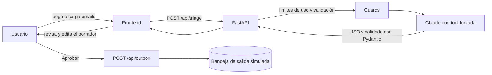

# Bandeja inteligente

Triaje de emails para empresas con IA: **clasifica** (presupuesto, incidencia, factura, comercial), **prioriza**, **extrae los datos clave** y **redacta un borrador de respuesta**. Nada sale sin que una persona lo apruebe.

> Captura o GIF de la demo aquí (`docs/demo.gif`).

## Para quién
Equipos pequeños que reciben decenas de emails al día y pierden tiempo decidiendo qué atender primero y escribiendo respuestas repetitivas.

## Arranque rápido

```bash
git clone <este-repo> && cd bandeja-inteligente
python -m venv .venv && source .venv/bin/activate
pip install -r requirements.txt
cp .env.example .env          # opcional: añade ANTHROPIC_API_KEY para usar Claude
uvicorn app.main:app --reload # abre http://localhost:8000
```

Sin API key arranca en **modo demo** (reglas simples, sin IA) para poder probar la interfaz. Con clave usa Claude.

Con Docker: `docker build -t bandeja . && docker run -p 8000:8000 --env-file .env bandeja`

## Cómo funciona



## Decisiones técnicas

- **Salida estructurada por herramienta forzada.** Se obliga al modelo a llamar a `registrar_triaje` (`tool_choice`), así que no puede devolver texto suelto. La respuesta se valida con Pydantic antes de llegar a la interfaz.
- **Prompt injection.** El contenido del email es dato no fiable: va delimitado en `<email>` y el prompt de sistema prohíbe obedecer órdenes que vengan dentro. Si el email intenta manipular a la IA, el resultado incluye `alerta_seguridad` y se marca para revisión humana. Hay un ejemplo en los datos de prueba (`s08`).
- **La IA no envía nada.** Solo redacta. No existe código de envío: la "bandeja de salida" es simulada, y es la puerta de aprobación humana.
- **Sin inventar datos.** `datos` solo recoge lo que aparece literalmente en el email; los borradores usan marcadores como `[indicar fecha]` en vez de prometer precios o plazos.
- **Revisión humana automática** cuando la confianza es baja, el tema es delicado (reclamación, dinero) o hay alerta de seguridad.
- **Coste y abuso.** Límite de emails por petición (20), de tamaño (6000 caracteres), de peticiones por minuto y de llamadas al modelo por hora. Modelo pequeño por defecto, configurable con `ANTHROPIC_MODEL`.
- **Un fallo no tumba el lote.** Si falla el análisis de un email, los demás siguen.
- **XSS.** El frontend construye el DOM con `textContent`; nunca inserta el contenido del email como HTML.

## Evaluación

12 emails de ejemplo con categoría y prioridad esperadas (`app/samples.py`).

```bash
python -m eval.run_eval
```

| Modo | Acierto categoría | Acierto prioridad | Latencia media | Tokens por email |
|---|---|---|---|---|
| Demo (reglas) | 12/12* | 12/12* | < 1 ms | 0 |
| Claude (`claude-haiku-5-5`) | _pendiente_ | _pendiente_ | _pendiente_ | _pendiente_ |

\* Las reglas del modo demo se ajustaron mirando estos mismos 12 emails, así que ese 100 % **no mide nada real**: solo comprueba que el modo demo es coherente. La fila de Claude se rellena ejecutando la evaluación con tu API key; con 12 casos es una prueba de humo, no un benchmark.

## Tests

```bash
pip install -r requirements-dev.txt
pytest
```
Cubren validación, extracción, prompt injection, límites de uso, bandeja de salida y la ruta con Claude (simulada, sin gastar tokens).

## Limitaciones y próximos pasos

- Los emails se pegan a mano: falta conectar un buzón real (IMAP o la API de Gmail) con permisos de solo lectura.
- La bandeja de salida y los límites viven en memoria; en producción irían a una base de datos.
- Evaluación pequeña: ampliar a 50-100 emails reales anonimizados y medir también la calidad de los borradores.
- Idioma: pensado para español.

## Stack
Python · FastAPI · Pydantic · Anthropic API (tool use) · HTML/CSS/JS sin framework · pytest · Docker

## Licencia y contacto
MIT. Francisco Javier García López · [LinkedIn](https://www.linkedin.com/in/francisco-javier-garcia-lopez) · [GitHub](https://github.com/Javigarcilop)
